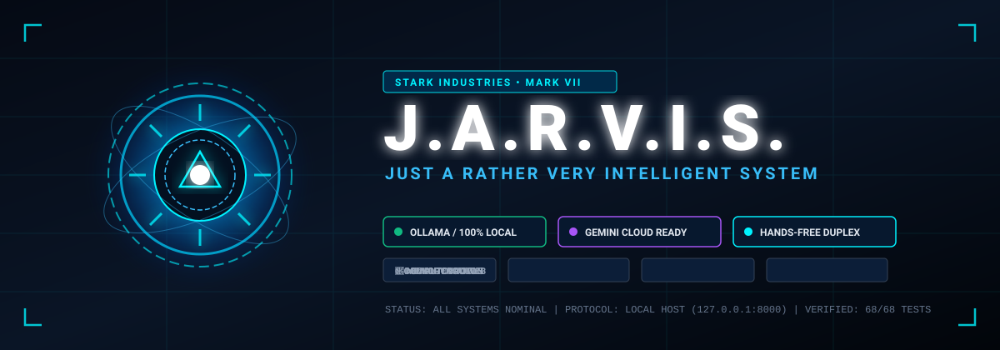
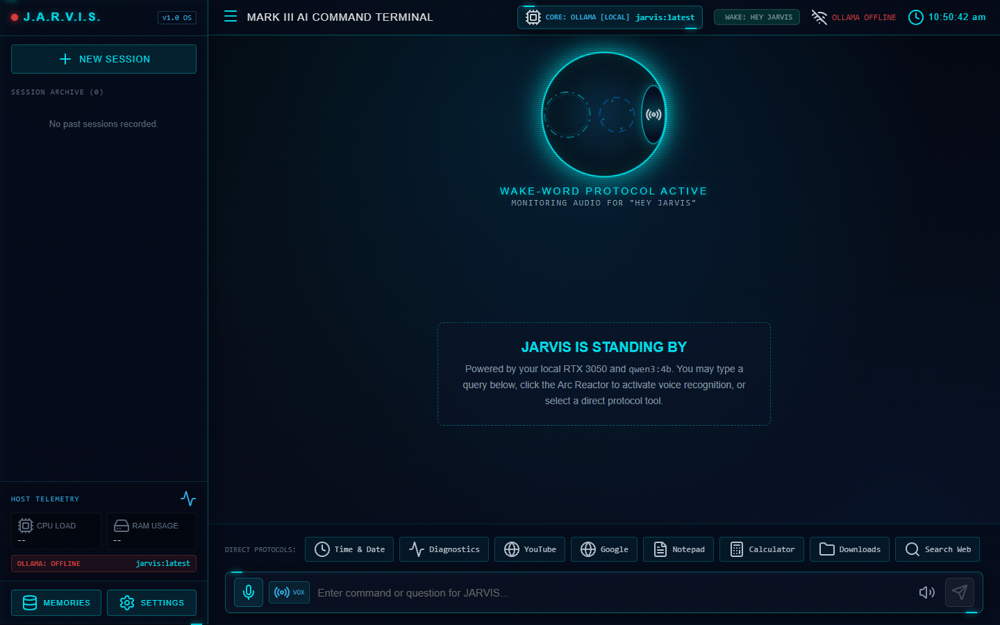
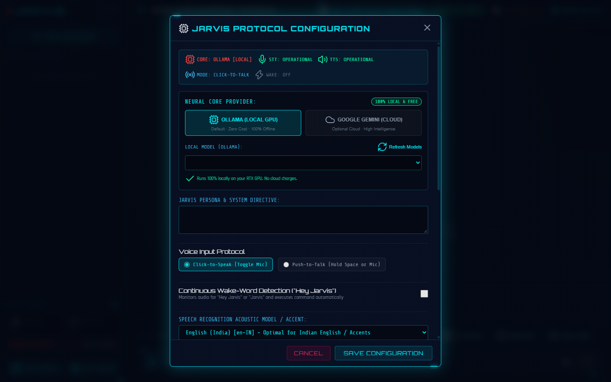
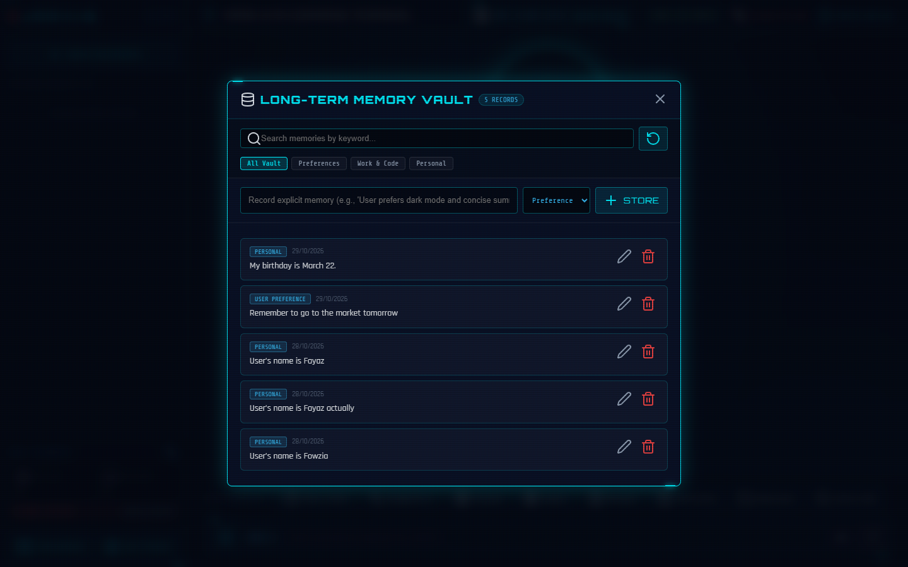
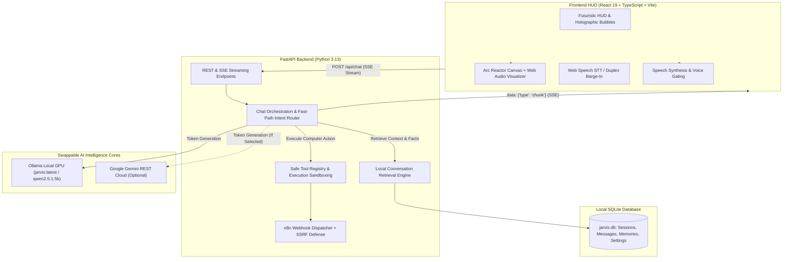

<div align="center">



# J.A.R.V.I.S. // Autonomous AI Desktop Assistant
### *Just A Rather Very Intelligent System — Inspired by Tony Stark's Iron Man Assistant*

[](https://python.org)
[](https://fastapi.tiangolo.com)
[](https://react.dev)
[](https://www.typescriptlang.org)
[](https://vitejs.dev)
[](https://ollama.ai)
[](https://ai.google.dev/)
[](https://pytest.org)
[](LICENSE)

<br/>

**J.A.R.V.I.S.** is an offline-first, low-latency, privacy-preserving desktop AI assistant with an Iron Man inspired futuristic HUD, real-time audio visualizer, safe computer-control tools, persistent cross-session memory, and dual-brain architecture (Local Ollama default + optional Google Gemini Cloud).

</div>

---

## 📸 Interface Showcase & Visual Overview

### 1. Main Command Center & Arc Reactor HUD
> Real-time Canvas 2D Arc Reactor responsive to live microphone RMS levels, fast token streaming, telemetry monitors (CPU, RAM, Disk), and one-click protocol tools.

<div align="center">
  
</div>

<br/>

### 2. Dual Neural Core & Settings Modal
> Instant switching between **100% Free Local GPU (Ollama / Qwen)** and **Google Gemini Cloud AI**. Complete privacy safeguards with automatic secret masking (`••••••••`) and cost alerts.

<div align="center">
  
</div>

<br/>

### 3. Persistent Memory Vault & Cross-Session Recall
> Long-term memory store allowing the user to view, search, categorize, edit, or delete personal facts and preferences remembered by J.A.R.V.I.S.

<div align="center">
  
</div>

---

## ⚡ Core Capabilities

- 🔒 **100% Local & Cost-Free Default**: Runs inference on your local NVIDIA GPU (e.g. RTX 3050 4GB) using Ollama. Never requires cloud subscriptions or credit cards.
- ⚡ **Dual Neural Core**: Default local `jarvis:latest` / `qwen2.5:1.5b` with an optional, opt-in Google Gemini cloud provider (`gemini-1.5-flash`, `gemini-2.0-flash`).
- 🎙️ **Hands-Free Duplex Voice**: Native browser Web Speech recognition with acoustic homophone normalization (correctly detects *Fayaz*, *Jarvis*, *ChatGPT*), British speech synthesis, and duplex barge-in (interruption on speech).
- 🧠 **Persistent Long-Term Memory**: Automatically learns user details (name, preferences, directories) and stores them in a local SQLite database for cross-session recall.
- 🔍 **Relevant Conversation Retrieval**: Automatically searches past archived sessions to recall relevant context and prior answers.
- 🛠️ **Sandboxed Computer Controls**: Safely launch desktop applications, inspect system performance, navigate approved folders, read documents, and terminate tasks (with two-step confirmation).
- 🌐 **Live Web Search**: Built-in DuckDuckGo search extraction delivering real-time news, sports scores, and live facts without third-party API costs.
- 🔗 **Optional n8n Webhook Integration**: Trigger self-hosted workflow automations with strict anti-SSRF protection.

---

## 🏛️ System Architecture



---

## 📂 Repository Directory Tree

```
javis/
├── backend/
│   ├── app/
│   │   ├── main.py                  # FastAPI entry point, CORS & lifespan
│   │   ├── config.py                # System settings, allowlists, security filters
│   │   ├── api/                     # REST & SSE routers (chat, settings, memories, tools, voice)
│   │   ├── database/                # SQLite initialization and schema helpers
│   │   ├── providers/               # Modular LLM abstraction (OllamaProvider, GeminiProvider)
│   │   ├── services/                # Chat orchestration, retrieval, n8n, whisper
│   │   └── tools/                   # Sandboxed system automation tools & registry
│   ├── tests/                       # 68 automated Pytest unit and security tests
│   ├── requirements.txt             # Pinned backend dependencies
│   └── .env.example                 # Environment template
│
├── frontend/
│   ├── src/
│   │   ├── components/              # ArcReactor, ChatMessage, SettingsModal, MemoryManager, Sidebar
│   │   ├── services/                # api.ts (fetch/SSE stream), speech.ts (Web Speech duplex engine)
│   │   ├── types/                   # TypeScript interfaces (Conversation, Message, Settings)
│   │   ├── App.tsx                  # Master HUD layout & voice coordinator
│   │   └── index.css                # Glassmorphic dark cyberpunk styling
│   ├── package.json                 # Node dependencies
│   └── vite.config.ts               # Vite build configuration
│
├── docs/
│   └── images/                      # Screenshot assets and vector banners
├── scripts/
│   ├── start_all.bat                # Unified 1-click startup launcher
│   ├── start_backend.bat            # Backend FastAPI launcher with auto-restart
│   └── start_frontend.bat           # Frontend Vite launcher
├── JARVIS_PROJECT_HANDOVER.md        # Comprehensive 600-line architecture & specification report
├── Modelfile.fast                   # Fast Ollama model configuration
├── Modelfile.nothink                # Thinking-token suppression model configuration
├── start_jarvis.bat                 # Root launcher shortcut
└── README.md                        # Project documentation
```

---

## 🛡️ Security & Sandboxing Matrix

| Protection Domain | Implemented Security Mechanism |
| :--- | :--- |
| **No Shell Injection** | Arbitrary shell execution (`cmd /c`, `shell=True`) is completely prohibited. Commands are validated against a strict dictionary of approved binaries. |
| **Path Traversal Defense** | Document reader uses `Path.resolve()` and enforces `target.relative_to(base_dir)`. Rejects directory traversal (`../`) and protects `.env` or system files. |
| **Confirmation Barrier** | Sensitive tools (`delete_file`, `terminate_app`) strictly mandate an explicit confirmation step before executing. Core system processes are permanently protected. |
| **SSRF Defense** | n8n webhooks strictly validate URL schemes (`http`/`https`) and block cloud metadata IPs (`169.254.169.254`, `metadata.google.internal`). |
| **Secret Masking** | API keys and auth tokens are masked with `••••••••` in frontend responses. Plaintext secrets are never transmitted across the browser interface. |

---

## 🚀 Quick Start Guide (Windows)

### 1. Prerequisites
- **Python 3.10+** (Python 3.13 recommended)
- **Node.js 18+** & npm
- **Ollama**: Installed from [ollama.ai](https://ollama.ai)

### 2. Prepare Ollama Model
```powershell
# Pull base model
ollama pull qwen2.5:1.5b

# Or create customized JARVIS persona model
ollama create jarvis -f Modelfile.fast
```

### 3. One-Click Launch
Double-click **`start_jarvis.bat`** in the repository root or run:
```powershell
.\scripts\start_all.bat
```
*This starts the FastAPI backend on `http://127.0.0.1:8000`, the Vite dev server on `http://localhost:5173`, and opens your default browser automatically!*

---

## 🧪 Verification & Testing

Run the automated test suite verifying all 68 tests:
```powershell
$env:PYTHONPATH='.'
backend\venv\Scripts\pytest -v
```

Build the frontend for production:
```powershell
cd frontend
npm run build
```

---

## 📄 License & Credits

- Inspired by Marvel's **J.A.R.V.I.S.** / Iron Man (Tony Stark).
- Open-source under the [MIT License](LICENSE).
- Developed with dedication to private, local, and autonomous AI.
